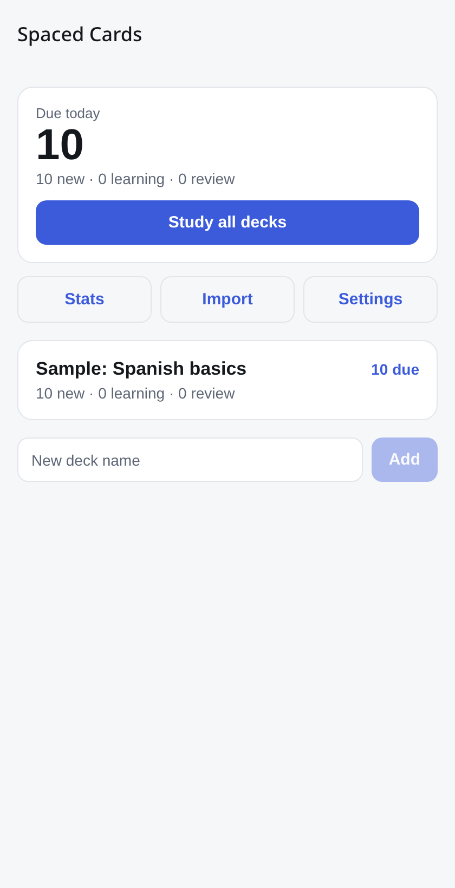
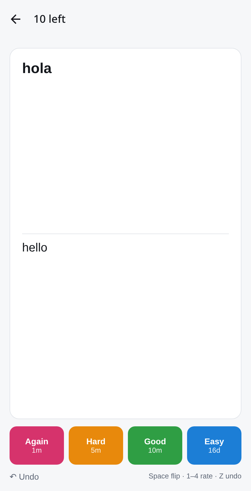
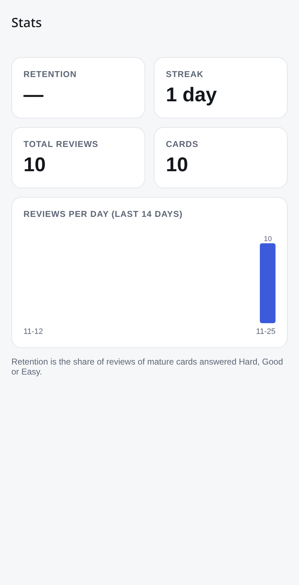

# Spaced Cards

A small, local-first flashcard app for Android, iOS and the web, built with React Native (Expo) and TypeScript. It schedules reviews with **FSRS**, the modern open spaced-repetition algorithm, and keeps all data on the device in SQLite.

| Home | Review | Stats |
|---|---|---|
|  |  |  |

A 60-second walkthrough is in [`docs/demo.mp4`](docs/demo.mp4).

## Features

- Decks and cards with Markdown (bold, italic, code, lists, images).
- Review screen with Again / Hard / Good / Easy, the next interval shown on every button, and **undo of the last rating**.
- Keyboard shortcuts on web and hardware keyboards: `Space` flip, `1`-`4` rate, `Z` undo.
- Fixed-size card area: flipping a card never moves the layout.
- FSRS-5 scheduler with a configurable desired retention (70-99%).
- Daily limits for new cards and reviews (the study day rolls over at 4 am), a "due today" count per deck, reviews-per-day chart, retention and streak.
- Import from **CSV** and from **Anki "Notes in Plain Text"** exports, with a report of skipped rows and converted content (clozes flattened, audio dropped) before anything is written.
- Export to CSV or JSON (JSON includes the full review history).
- Crash-safe: a rating and its history row are written in one SQLite transaction.

## Project layout

```
packages/fsrs   FSRS-5 scheduler, pure TypeScript, no dependencies
packages/core   import/export, daily queue, stats, storage interface + SQLite and in-memory repos
app             Expo app (expo-router screens, expo-sqlite on devices, localStorage on web)
scripts         headless-Chrome smoke test + screenshot/demo recorder for the web build
```

All logic lives in the two packages and is tested without a device. The app is a thin UI over `StudyService`.

## The scheduler

`packages/fsrs` implements FSRS-5 from the published formulas: forgetting curve `R(t,S) = (1 + (19/81)·t/S)^-0.5`, difficulty with linear damping and mean reversion, separate stability updates for recall, lapse and same-day steps, and interval = the time for retrievability to fall to the desired retention. Learning steps are 1/5/10 minutes. Fuzzing is left out so scheduling is deterministic.

Tests (`npm test`):

- formula-level checks (R = 0.9 when t = S, bounds on difficulty, Hard < Good < Easy, early reviews grow stability less);
- the full state machine (New, Learning, Review, Relearning);
- an **oracle comparison**: stability, difficulty, state, due time, reps and lapses are checked step by step against the independent [`ts-fsrs`](https://github.com/open-spaced-repetition/ts-fsrs) 4.7.1 implementation over hand-written, late/early and 25 randomised review histories.

The storage layer is tested with one contract suite run against both repos. The SQLite repo runs against a real database through `node:sqlite`.

## Run it

```bash
npm install
npm test                  # scheduler, core and storage tests
npm run typecheck

cd app
npx expo start            # scan the QR code with Expo Go, or press a / i / w
```

### Web demo

```bash
npm run e2e:web           # builds the web export, drives it in headless Chrome, refreshes docs/*.png
node scripts/record-demo.mjs
```

The web build stores data in `localStorage` (the SQLite module is native-only here), so it is a demo, not the primary target. `.github/workflows/deploy-web.yml` publishes it to GitHub Pages.

### Android APK

Tagging a release (`git tag v0.1.0 && git push --tags`) runs `.github/workflows/release-android.yml`, which builds an APK with EAS and attaches it to the GitHub Release. It needs an `EXPO_TOKEN` repository secret. To build locally instead:

```bash
cd app && npx expo prebuild --platform android && cd android && ./gradlew assembleRelease
```

The APK is signed with the debug keystore until you configure your own for Play. iOS builds go through EAS (`eas build --platform ios`) and need a paid Apple developer account for device install or TestFlight.

## Import formats

- **CSV**: columns `front,back[,tags]`, with or without a header row (`front/question/term`, `back/answer/definition`, `tags`). `,` `;` and tab delimiters are detected.
- **Anki**: File → Export → "Notes in Plain Text". Header lines `#separator`, `#html` and `#tags column` are honoured. Only the first two fields of a note are used.

## Not in v1

Cloud sync, shared decks, accounts, handwriting, optimising FSRS weights from your own history, and media files bundled inside Anki `.apkg` packages.

## Licence

MIT. No code or assets from Anki are used.
